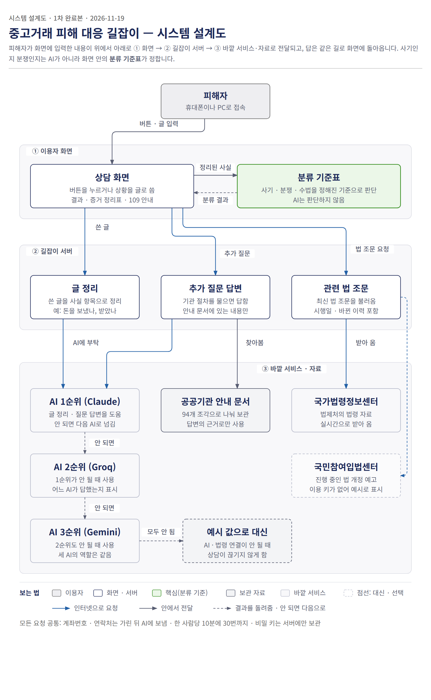

# 중고거래 피해 대응 길잡이

온라인피해 365센터의 중고거래 피해 상담을 돕는 **진단 · 안내 도구 시제품**입니다. (공공행정 프로젝트 1조)

피해자가 버튼을 누르거나 상황을 글로 쓰면, 길잡이가 사실을 정리해 **사기 의심 · 거래 분쟁 · 범위 밖 · 판단 어려움**으로 나누고, 먼저 가야 할 기관과 지금 할 일, 기관에 낼 **증거 정리표**를 만들어 줍니다. 사기인지 판정하지 않고 "어디에 먼저 가야 하는지"를 안내합니다.

## 할 수 있는 일

- **상황 진단**: 자주 겪는 상황 8가지를 바로 고르거나 직접 글로 씁니다. 모르는 것만 버튼으로 다시 묻습니다.
- **분류 기준표**: 사기 · 분쟁은 AI가 아니라 정해진 규칙표가 판단합니다. 사기 의심은 수법(가짜 안전결제 링크, 쿠폰 · 상품권 사기, 물건 미발송 · 잠적, 보이스피싱 연계)별로 다른 기관을 안내합니다.
- **증거 정리표**: 날짜 · 금액 · 계좌 · 상대방 정보를 묻고, 캡처를 올리면 정리표와 원본을 ZIP 하나로 내려받거나 인쇄 · PDF로 저장합니다.
- **추가 질문 · 근거 법령**: 기관 절차를 물으면 공공기관 안내 문서에 있는 내용으로만 답하고, 관련 법 조문을 실시간으로 보여 줍니다.
- **안전 장치**: 위기 표현이 있으면 109 자살예방 상담전화를 먼저 안내합니다. 계좌번호 · 연락처는 가린 뒤 AI에 보내고, 정리표 내용과 캡처는 서버로 보내지 않습니다.

## 시스템 설계도



PDF: [docs/시스템설계도.pdf](docs/시스템설계도.pdf)

## 폴더 구성

| 폴더 · 파일 | 하는 일 |
|---|---|
| `public/` | 이용자가 보는 화면(대화 · 결과 · 정리표, 분류 기준표 `rules.js`) |
| `api/` | 서버 기능(글 정리, 추가 질문 답변, 근거 법령) |
| `docs/답변참고문서/청킹/` | 답변의 근거로 쓰는 공공기관 안내 문서 조각 |
| `server.js` | 내 컴퓨터에서 실행할 때 쓰는 서버 |
| `vercel.json` | Vercel 배포 설정 |

## 내 컴퓨터에서 실행

1. Node.js 20 이상을 설치합니다.
2. 폴더에 `.env` 파일을 만들고 키를 넣습니다(깃허브에는 올리지 않습니다).
   - `CLAUDE_API_KEY`, `GROQ_API_KEY`, `GEMINI_API_KEY` — AI(앞이 안 되면 다음으로 넘어감)
   - `LAW_OC` — 국가법령정보 조회, `LAWMAKING_OC` — 입법예고 조회(없으면 예시 값으로 표시)
3. 아래 명령을 실행하고 http://localhost:3000 을 엽니다.

```bash
npm install
npm start
```

## 알려 둘 점

- 이 안내는 법적 판단이 아닙니다. 수사 · 사기 여부 확정 · 피해금 회수 · 기관 자동 접수는 하지 않습니다.
- 시험에는 지어낸 사례만 씁니다. 실제 개인정보를 넣지 마세요.
